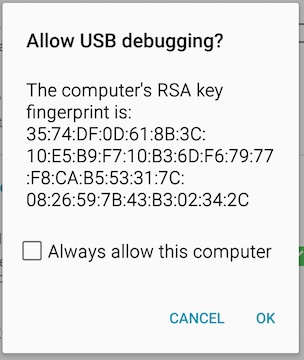

[](https://github.com/appium/appium-docker-android/actions/workflows/release.yml)
[](https://hub.docker.com/r/appium/appium/)
[](https://microbadger.com/images/appium/appium)


# Appium Docker for Android

## Why is this approach needed at first place?

- Helps in quick & easier setup of automation environment for Appium + Android
- Without this approach, you'll need to do each of the automation setup steps manually; which can be slow and error prone

## Images Included:

- appium/appium - Docker Image to run appium tests on real Android devices.
- To execute in Android emulator's please visit [docker-android](https://github.com/budtmo/docker-android)

## How to Build:

	$ docker build -t "appium/appium:local" -f Appium/Dockerfile Appium

On ARM64 machines (e.g. Apple Silicon macOS or ARM64 Linux), pass `--build-arg TARGETARCH=arm64`:

	$ docker build --build-arg TARGETARCH=arm64 -t "appium/appium:local" -f Appium/Dockerfile Appium


## Quick Start

1. Connect Android device to the machine via USB

2. Run Appium-Docker-Android

	```
	$ docker run --privileged -d -p 4723:4723  -v /dev/bus/usb:/dev/bus/usb --name appium-container appium/appium
	```

	OR you can get the id of the device via this command ```ls -l /dev/serial/by-id``` and pass the device-id to container to have more security

	```
	docker run --privileged -d -p 4723:4723 --device=/dev/<your-device-id> --name appium-container appium/appium
	```

3. Run following command to verify adb devices can detect the connected android device.

	```
	$ docker exec -it appium-container adb devices
	```

	On Windows and macOS (Docker Desktop without direct USB pass-through), start the ADB server on the host machine (`adb -a nodaemon server start`) and specify the host as `host.docker.internal`:

	```
	$ docker exec -it appium-container adb -H host.docker.internal devices
	```

4. Run UI Test with following test configuration

	```
	Push the apk file into the container
	$ docker cp /home/myuser/localfolder/app-debug.apk appium-container:/home/androidusr/sample.apk

	Desired Capabilities:

	private void androidSetup() throws MalformedURLException {
	        caps.setCapability("deviceName", "Android");
	        caps.setCapability("app", "/home/androidusr/sample.apk");
	        //Get the IP Address of boot2docker
	        //docker inspect $(docker ps -q) | grep IPA
	        driver = new AndroidDriver<MobileElement>(new URL("http://xx.xx.xx.xx:4723/wd/hub"), caps);
	}
	```

	On Windows and macOS, set the capability `appium:remoteAdbHost` to `host.docker.internal` (supported by UiAutomator2, Espresso, and Flutter drivers) and connect to `http://localhost:4723` (or `http://host.docker.internal:4723` from another container).

## Additional configuration

### Share Android identification key

Each time, you will (re)create container, connected to container devices will ask for authorization after first
 connection.  To prevent that, you can share one identity through all created containers. To do that, you should:

- Connect all devices to docker physical machine
- Run `adb devices`
- Authorize all devices (do not forget to check **Always allow this computer**)



- run your containers with parameter `-v ~/.android:/home/androidusr/.android`

For example:
```
$ docker run --privileged -d -p 4723:4723 -v ~/.android:/home/androidusr/.android -v /dev/bus/usb:/dev/bus/usb --name appium-container appium/appium
```

### Connect Each Device to a Separate Container

In certain use cases you may want to have a single Appium-Docker-Android container running for each device. To achieve this you must run `adb kill-server`, provide the `--device` option to `docker run`, and set `-e ADB_LIBUSB=0` so `adb` inside each container only accesses the mounted USB device:

```
$ docker run -d -p 4723:4723 -e ADB_LIBUSB=0 --device /dev/bus/usb/XXX/YYY:/dev/bus/usb/XXX/YYY -v ~/.android:/home/androidusr/.android --name device1 appium/appium
$ docker run -d -p 4724:4723 -e ADB_LIBUSB=0 --device /dev/bus/usb/XXX/ZZZ:/dev/bus/usb/XXX/ZZZ -v ~/.android:/home/androidusr/.android --name device2 appium/appium
```

### Connect to Android devices by Air

Appium-Docker-Android can be connected with Android devices by Air.

To do that you need to configure android device, according to [official manual](https://developer.android.com/studio/command-line/adb.html#wireless)

Then run docker container with following parameters:

- REMOTE\_ADB=true
- ANDROID\_DEVICES=\<android\_device\_host\>:\<android\_device\_port\> \[,\<android\_device\_host\>:\<android\_device\_port\>\]
- REMOTE_ADB_POLLING_SEC=60 (default: 5, interval between polling the list of connected devices in order to connect to lost remote devices)

```
$ docker run -d -p 4723:4723 -e REMOTE_ADB=true -e ANDROID_DEVICES=192.168.0.5:5555,192.168.0.6:5555 -e REMOTE_ADB_POLLING_SEC=60
```

### Additional Appium parameter

APPIUM_ADDITIONAL_PARAMS="<additional-appium-parameter-here>", e.g. ```--relaxed-security --allow-insecure chromedriver_autodownload --allow-insecure adb_shell```

### Using Appium Plugins

To install and enable Appium plugins when starting the container, pass a comma-separated list of plugin names via `APPIUM_PLUGINS`:

```
$ docker run --privileged -d -p 4723:4723 -e APPIUM_PLUGINS="images,execute-driver" -v /dev/bus/usb:/dev/bus/usb --name appium-container appium/appium
```

### Connect to Selenium Grid

In Appium 2 and 3, Selenium Grid 4 connects to the Appium server via a Grid 4 `[relay]` TOML configuration (see [`examples/selenium-grid-4.toml`](examples/selenium-grid-4.toml)):

```toml
[events]
publish = "tcp://selenium_hub:4442"
subscribe = "tcp://selenium_hub:4443"

[server]
port = 5555

[node]
detect-drivers = false

[relay]
url = "http://appium_android_device:4723"
status-endpoint = "/status"
protocol-version = "HTTP/1.1"
configs = [
  "1", '{"platformName": "Android", "appium:automationName": "UiAutomator2"}'
]
```

### Running without `--privileged` (e.g. `dockremap` / `userns-remap`)

When `--privileged` cannot be used on the Docker host (such as when user namespace remapping / `dockremap` is enabled), run the ADB server on the host machine (`adb -a nodaemon server start`) and point the container and Appium session to the host ADB server without setting `REMOTE_ADB=true`:

```
$ docker run -d -p 4723:4723 -e ANDROID_ADB_SERVER_ADDRESS=host.docker.internal -e ANDROID_ADB_SERVER_PORT=5037 --add-host=host.docker.internal:host-gateway --name appium-container appium/appium
```

In your test capabilities, set `appium:remoteAdbHost` (e.g. `"host.docker.internal"`), `appium:remoteAdbPort` (`5037`), and `appium:udid` (`"<device-serial>"`) so `adb` targets the intended device when multiple devices or emulators are attached.

### Docker compose

There is [an example of compose file](examples/docker-compose.yml) to simulate the connection between Selenium Hub (Grid 4), a Selenium Relay Node, and the Appium server with connected device(s) in a Docker solution.

```
$ docker compose -f examples/docker-compose.yml up -d
```
